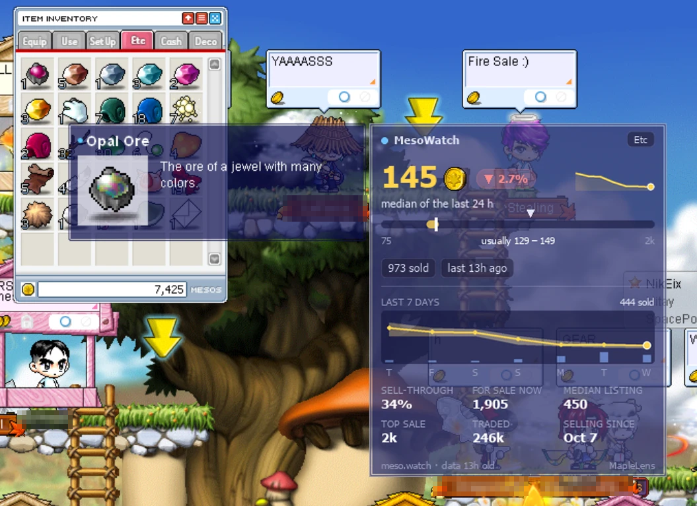
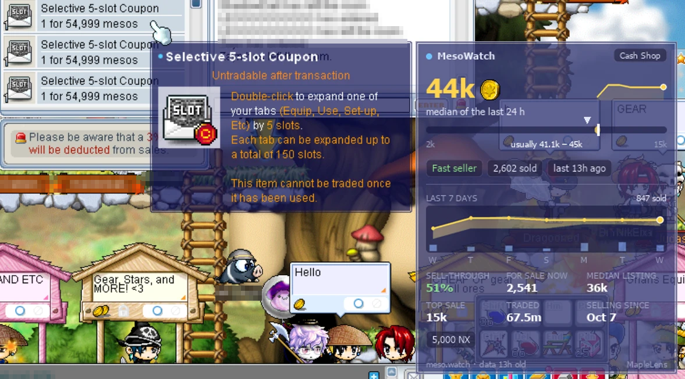
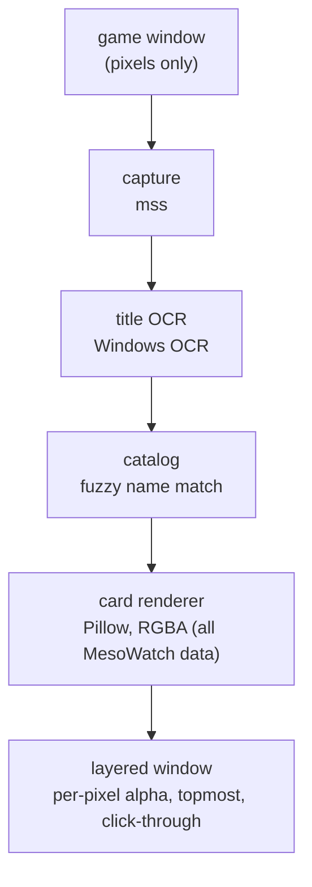

<div align="center">


# MapleLens

**In-game overlays for MapleStory Classic.**
Hover an item, see what it is worth. No injection, no memory reading, no game files touched.




</div>

## ✨ Features

| | |
|---|---|
| 🪙 **Live price card** | Hover any inventory item and a card appears beside its tooltip with the [MesoWatch](https://meso.watch) price. |
| 🏆 **Player rank panel** | Open a player's **Character Info** window and a panel in the game's own style (pink labels, beige boxes) appears on its left with their world, job and fame rank from the public [classicrank.com API](https://classicrank.com/developer) (no key; cached, rate‑limit friendly). Falls back to the right side, or hides, if there is no room inside the game. |
| 🧭 **Smart placement** | Right of the tooltip; left near the screen edge; below for equipment compare (two tooltips). |
| 🎨 **Truly translucent** | Per‑pixel alpha like the game's own box (see‑through fill, solid text), Tahoma font, same borders and bullet. |
| 👀 **Glance first, details on dwell** | Hover and you get the answer at once: price, trend, week sparkline, where the price sits in its range, how it sells. Keep the pointer on the item for ~1 s and the card grows into the full view. |
| 📈 **Everything MesoWatch knows** | Typical price + basis, trend, price‑range bar, 7‑day median/low‑high chart with volume bars, sales, sell‑through, listings, shops, traded volume, first sale. |
| 💡 **Insights** | Fast/slow seller, low‑data warning (`~` before the price), scrolled sales, NPC floor price, crafting profit, NX price, drop sources. |
| 🔢 **Readable numbers** | `1320 → 1.32k`, `10500 → 10.5k`, `2300000 → 2.3m`. |
| ⚡ **Keeps up with your mouse** | Captures only around the cursor and skips repeat OCR, so the card follows at the speed you move. |
| 🧊 **Rock steady** | Placed from the mouse position, not from per‑frame detection, so nothing jitters. |
| 🪟 **Game only** | Shown only while MapleStory is the front window, and always clamped inside it. |
| 👻 **Click‑through** | The overlay never steals mouse input from the game. |
| 🔍 **Typo tolerant** | OCR slips such as `Emerald 0re` still resolve to the right item. |
| 🛡️ **Screen‑only** | Reads pixels from the game window. Nothing is injected into or read from the game process. |

## 🖼️ Showcase

Real screenshots of MapleLens running in the game. Other players' name plates are pixelated; the price numbers are one
item's figures from MesoWatch (used with permission), credited on the card.

### 🪙 Item price overlay


Point at an item in your inventory (here **Opal Ore**) and the card appears beside the game's own tooltip.

- **Price** in gold with the meso coin, a **trend pill** (green up / red down) and a **week sparkline**.
- **Range bar:** the dark groove is the lowest to highest sale seen, the gold band is where most sales happen (labelled underneath), the white tick is the typical price. The blue **in shops N** arrow is the median price shops list it for right now, on the same scale; it turns amber when shops ask 20%+ more than it actually sells for.
- **Signal pills:** how fast it sells, how many sales, how recent the last one is.
- **Full card** (shown above after about a second on the item) adds the 7-day chart with volume bars, market depth (sell-through, items for sale, shops, traded volume) and where the item comes from.
- It sits **right of the tooltip**, **left** near the screen edge, and **below** when an equipment compare tooltip is open.
- Translucent like the game's own tooltip, at the game's text size.

**Two sizes of the same card** (demo numbers):

| Glance: what you see when you hover | Full: after keeping the pointer on the item |
|---|---|
|  |  |

### 🛒 In shops and on Cash Shop items



It works the same inside a player's shop window: here a **Selective 5-slot Coupon** listed at 54,999 mesos next to a
card showing the market median (44k), a "Fast seller" pill and the NX price (5,000 NX). Shops are where a quick
"is this listing cheap?" glance matters most.

### 🏆 Player rank panel


Open a player's **Character Info** window and the ranking panel appears beside it, in the game's own window style
(pink labels, beige boxes), with their world, job and fame rank from the public classicrank.com API.

## 🚀 Quick start (for developers)

> Requires Windows 10/11 and Python 3.11+. The game window must be visible (not covered by other windows).

```bash
git clone <this repo> maplelens && cd maplelens
pip install -e .
maplelens            # automatically refreshes the local price cache
```

| Flag | What it does |
|---|---|
| `--snapshot PATH` | Use a local `list.json` without automatic updates |
| `--debug` | Also log detection details to `maplelens.log` and save each new tooltip capture to `debug/` |
| `--version` | Print the version |

MapleLens always writes warnings and errors (plus start-up info) to `maplelens.log` next to `maplelens.exe`. If something
breaks, send that file along with your report.

Never used a terminal? Follow the guide below instead.

## 🧸 Step-by-step guide for complete beginners

You do not need to know anything about programming. It takes about 10 minutes, and you only do steps 1–3 once.

### 1. Install Python (the engine that runs MapleLens)

1. Go to <https://www.python.org/downloads/> and click the big yellow **Download Python** button.
2. Open the file you downloaded.
3. ⚠️ **On the very first screen, tick the box "Add python.exe to PATH"** (bottom of the window). This is the one step people miss.
4. Click **Install Now**, wait, then click **Close**.

### 2. Get MapleLens and install it

1. Put the whole `maplelens` folder somewhere easy, for example `C:\MapleLens` (if you downloaded a ZIP, right‑click it → **Extract All**).
2. Open the folder and **double‑click `install-maplelens.bat`**.
3. A black window appears and downloads what MapleLens needs (about a minute). When it says **Done**, press any key to close it.

> Windows may show a blue "Windows protected your PC" box for the `.bat` file. Click **More info → Run anyway**. The file is plain text: you can open it in Notepad and read it.

### 3. About the price data

MapleLens downloads missing price data and refreshes its local cache hourly while running. Failed updates keep
the last usable cache; without one, the app uses built-in demo items. Data files remain excluded from Git.

### 4. Start it

1. Start MapleStory Classic and log in.
2. **Double‑click `start-maplelens.bat`.** A black window opens and says `Using 3 built-in demo items` (or `Loaded … items` if a price data file is installed). Leave it open.
3. Click on the game, open your inventory (or any shop) and **hover an item**. A price card appears next to the item's tooltip. 🎉

To stop MapleLens, close the black window.

### If something goes wrong

| Problem | What to do |
|---|---|
| `Python is not installed` / `'python' is not recognized` | Redo step 1 and make sure you ticked **Add python.exe to PATH**, then run `install-maplelens.bat` again. |
| It says `Using 3 built-in demo items` | That is demo mode: no price data is installed (see step 3). Only Emerald Ore, Tree Branch and a couple of made-up examples show prices. |
| Nothing appears when I hover | The game must be the **front window** (click on it). Run both the game and MapleLens the normal way (not one "as administrator" and the other not). |
| Card shows "No price data" | That item has no sales on MesoWatch yet, or the game name was misread. Try hovering again. |
| The card is in the wrong place | Only the default UI layout is calibrated. Tooltips flipped to the other side of the mouse (near the right/bottom screen edge) are not supported yet. |
| It says OCR is unavailable | Windows needs an English language pack: **Settings → Time & language → Language & region → Add a language → English**, then restart. |
| Anything else | Run `start-maplelens.bat`, copy the red text in the black window and ask for help. |

## ⚠️ Can I get banned?

**Short answer: probably not, but nobody outside Nexon can promise it.** MapleLens is not made, approved or endorsed
by Nexon, and Nexon has not published a rule that says overlays like this are allowed or banned.

**What MapleLens does, technically.** It works like a screen recorder with a see‑through window on top:

| Anti-cheat looks for… | MapleLens |
|---|---|
| Reading or writing game memory | ❌ Never. It only reads screen pixels, like OBS or a screenshot. |
| Injecting code, DLLs or hooks into the game | ❌ Never. |
| Pressing keys or clicking for you | ❌ Never. It only reads where your mouse already is. |
| Changing game files or network traffic | ❌ Never. Its only downloads are MesoWatch prices and classicrank.com ranks. |
| Playing the game for you | ❌ Never. It shows information; you do everything yourself. |

The only time it touches the game process is a quick check of the program name (`maplestory.exe`) to find the game
window. That uses the same read‑only query as Task Manager, and only at startup or when the window is lost.

**What Nexon's rules say.** Nexon's
[User Abuse policy](https://support-maplestory.nexon.com/hc/en-us/articles/204737315-What-activities-constitute-User-Abuse)
bans botting and using "a third-party program … to play the game in a manner that is not intended by the creators",
with penalties up to a permanent ban at Nexon's discretion. It does not mention overlays, and Nexon keeps
[no public list](https://forums.maplestory.nexon.net/discussion/18521/enclose-list-of-3rd-party-programs-names) of
allowed or banned programs. MapleLens does not automate anything, but the wording is broad and Nexon decides.

## 🧠 How it works



1. **Capture** a small patch at the mouse position plus a fixed offset: the game always draws the item tooltip there. Nothing is captured or drawn while the game is not the foreground window.
2. **Check** a tooltip is there (a recognised title is the proof; the blue fill is only a fallback). Equipment also reads a second title further right to spot compare mode.
3. **Read** the title row with the Windows OCR engine (3× upscaled, inverted for accuracy). Results are cached on the text mask, so a moving tooltip is never re-OCR'd.
4. **Match** the text against the MesoWatch catalog (exact key first, then fuzzy).
5. **Render** the card once per item with Pillow, then **place** it from the live mouse position every tick (so it moves with the mouse, not with detection latency).

## 🗂️ Project layout

```
src/maplelens/
├── cli.py            argument parsing, entry point
├── app.py            wires pipeline ➜ overlay on the UI thread
├── pipeline.py       background loop: frame ➜ tooltip ➜ title ➜ item
├── config.py         tunable constants
├── geometry.py       Box primitive
├── capture/          game window lookup, screen grabbing
├── vision/           tooltip presence check, OCR
├── market/           item model, snapshot loader, fuzzy catalog, insights, formatting
├── overlay/          card renderer (widgets/canvas/theme), placement, layered window
└── assets/           meso coin (PNG + SVG)
tests/                pytest suite with a real in-game screenshot fixture
```

See [AGENTS.md](AGENTS.md) for architecture rules and how to extend it.

## 📜 Data, terms and licences

**This project.** MapleLens is open source under the [MIT license](LICENSE). The license covers MapleLens' own code
only: not MesoWatch's data, not NEXON's artwork (the meso icon below), and not the game.

**MesoWatch.** Prices belong to [MesoWatch](https://meso.watch). MapleLens does not bundle their data, and
`data/*.json` is git‑ignored so nobody commits it by accident. Every card shows a visible "meso.watch" credit.

**The game.** MapleStory and its artwork belong to NEXON; this is an unofficial fan project. MapleLens only reads
screen pixels (no injection, no memory access, no input automation), but I could not find an official Nexon rule that
specifically covers overlays for MapleStory Classic, and Nexon support generally does not help with third‑party
software. Check the current Nexon Terms of Service yourself and use it at your own risk (see
**Can I get banned?** above).

**Icon.** The meso coin is the game's item icon (`09000001`) as served by [maplestory.io](https://maplestory.io),
© NEXON. It is included as a small fan‑project asset; replace it if you redistribute this project.

## 🛠️ Development

```bash
pip install -e ".[dev]"
pytest          # unit tests + OCR/detection test on a real screenshot
ruff check .
```

## 📦 Releases (maintainers)

Versioning is [SemVer](https://semver.org); the single source is `__version__` in `src/maplelens/__init__.py`.

```bash
python scripts/bump_version.py patch     # or minor / major / X.Y.Z
git commit -am "Release 0.1.1" && git tag v0.1.1 && git push --follow-tags
```

Pushing a `v*.*.*` tag runs `.github/workflows/release.yml`: lint, tests, PyInstaller build (`maplelens.spec`),
a `--version` smoke test, then a GitHub Release with `maplelens-vX.Y.Z-windows.zip` (exe, README, LICENSE) and
its SHA-256. Tags containing `-` (e.g. `v0.2.0-rc1`) are marked pre-release. No price data is ever bundled.
`ci.yml` runs lint and tests on every push and PR.
